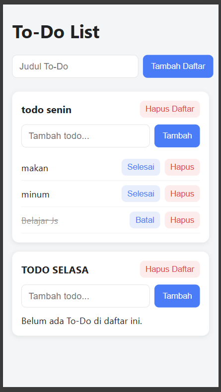

# To-Do List

Aplikasi to-do list sederhana dengan banyak daftar, mirip aplikasi Catatan.

## Fitur

- Membuat dan menghapus daftar
- Menambah, mencentang, dan menghapus todo di dalam daftar
- Data tersimpan otomatis di localStorage
- Tampilan responsif

## Teknologi

HTML, CSS, JavaScript (tanpa library), localStorage

## Cara menjalankan

Buka `index.html` di browser.

## Yang dipelajari

Array dan object, method array (`find`, `filter`, `forEach`), DOM, event listener, closure, JSON, localStorage.

## Screenshot

